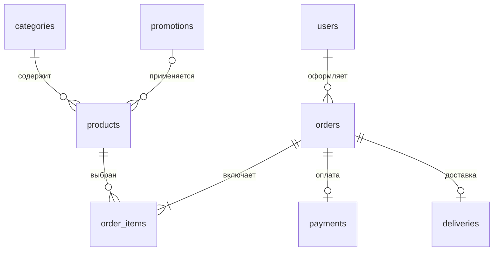

# TechStore — компьютерный магазин

Законченный учебный проект для ОСПО, ЛР3–6, вариант №34. FastAPI, PostgreSQL, SQLAlchemy, Jinja2, HTML/CSS/JavaScript, Bootstrap 5. Русский интерфейс, реальные бренды, локальные фотографии товаров и шрифты: витрина работает без внешних CDN.

## Быстрый запуск на этом компьютере

Из PowerShell в папке проекта:

```powershell
.\start.ps1
```

Откройте **http://localhost:8000**. Окно сервера оставьте открытым, остановка — Ctrl+C. PostgreSQL запускается отдельно и сохраняет данные после закрытия сайта. Если порт 8000 занят: `.\start.ps1 -Port 8001`.

Начальный администратор: `admin@techstore.local`, пароль **`Admin1! -_Tech`** (между `!` и `-` один обычный пробел). Это только начальные локальные учебные данные: после первого входа смените пароль в профиле. Для другого компьютера или облака задайте собственные `ADMIN_EMAIL` и `ADMIN_PASSWORD` до первого seed.

Демонстрационный покупатель: `demo@techstore.local`, пароль **`Demo1! -_Tech`**. Все данные вымышленные. У покупателя уже есть новый и доставленный заказы. Банковские данные не используются, реальные платежи не выполняются.

## Установка с нуля на Windows

Нужны Python 3.11+ (для Vercel — 3.12), Git и PostgreSQL. Используется уже установленный PostgreSQL; помощник не скачивает и не устанавливает сервер.

```powershell
git clone https://github.com/Olegzzg/TechStore.git TechStore
cd TechStore
python -m venv .venv
.\.venv\Scripts\python.exe -m pip install -r requirements.txt
.\.venv\Scripts\python.exe scripts\setup_local_db.py
.\start.ps1
```

Помощник создаёт **отдельный кластер PostgreSQL** в `.local/postgres` на `127.0.0.1:55433`, базу `techstore`, роль приложения без прав суперпользователя, случайный пароль БД и `SECRET_KEY`. Другие базы и службы не изменяются. Существующий `.env` помощник сохраняет. Не удаляйте `.local`: там данные БД. `.env` и `.local` никогда не публикуются в Git.

Если PostgreSQL расположен нестандартно или уже есть подходящий сервер, скопируйте `.env.example` в `.env`, задайте `DATABASE_URL`, случайный `SECRET_KEY` не короче 32 символов и собственный пароль администратора. Создайте отдельную роль и базу через pgAdmin или psql от администратора:

```sql
CREATE ROLE techstore LOGIN PASSWORD 'replace_with_your_password' NOSUPERUSER NOCREATEDB NOCREATEROLE;
CREATE DATABASE techstore OWNER techstore;
```

Затем выполните `.\.venv\Scripts\python.exe seed.py` и `.\start.ps1`. URL может использовать `postgresql://` или `postgresql+pg8000://`. Для TLS добавьте `?sslmode=require` либо `DATABASE_SSL=true`; сертификат проверяется. Спецсимволы пароля БД в URL кодируются percent-encoding.

## Назначение администратора

Пользователь регистрируется на сайте. Текущий администратор открывает **Администрирование → Покупатели → Изменить → Администратор → Сохранить**. Права читаются из БД на каждом запросе, поэтому вступают в силу сразу. При регистрации пользователь не может назначить себе эту роль.

Если вход администратора недоступен, используйте локальную команду:

```powershell
.\.venv\Scripts\python.exe scripts\set_admin.py user@example.com
.\.venv\Scripts\python.exe scripts\set_admin.py user@example.com --revoke
```

Последний администратор защищён от снятия прав через CLI. На сайте нельзя удалить собственный аккаунт или снять собственную роль.

## Что демонстрировать на лабораторных

| Работа | Возможности |
|---|---|
| ЛР3 | Главная с баннером, категории, поиск по названию/бренду/описанию, сортировка, страницы каталога, фотографии, карточка, корзина и оформление |
| ЛР4 | Регистрация со всеми дополнительными полями, вход/выход, кабинет, редактирование профиля и смена пароля |
| ЛР5 | Восемь таблиц PostgreSQL, PK/FK, ограничения CHECK/UNIQUE, Decimal/Numeric, демонстрационные записи |
| ЛР6 | Создание, чтение, изменение, удаление через семь разделов админки; роли и обработка связанных данных |

Пароль строго длиннее шести символов (7–128), содержит **каждый** из элементов: A–Z, a–z, цифру, отдельный спецсимвол (например `!`), обычный пробел, дефис `-`, подчёркивание `_`. Кириллица, табуляции и управляющие символы запрещены. Пробелы пароля не обрезаются. Пример допустимого пароля: `Study1! -_`. Хеширование — Argon2id с индивидуальной солью; исходные пароли в БД не хранятся. Изменяющие формы защищены CSRF, cookie — HttpOnly/SameSite. В публичном интернете дополнительно настройте ограничение частоты входа средствами платформы.

## Схема БД

| Таблица | Назначение и основные поля |
|---|---|
| `users` | email UNIQUE, password_hash, full_name, birth_date, address, gender, interests, vk_url, blood_group, rhesus, is_admin |
| `categories` | id, name UNIQUE |
| `promotions` | id, name, description, discount_percent, starts_on, ends_on |
| `products` | id, category_id FK, **promotion_id FK/NULL**, name, brand, image, description, price, stock |
| `orders` | id, user_id FK, status, address, created_at |
| `order_items` | id, order_id FK, product_id FK, quantity, price — снимок цены при оформлении |
| `payments` | id, order_id FK UNIQUE, amount, method, status |
| `deliveries` | id, order_id FK UNIQUE, address, method, status, tracking_number |



Акция действует включительно от starts_on до ends_on; цена уменьшается на процент и округляется до копейки. Заказ хранит цену на момент покупки, поэтому изменение каталога не изменяет историю. Сумма платежа берётся из заказа автоматически. Новый заказ создаёт позиции, платёж и доставку одной транзакцией. Строки товаров блокируются `SELECT FOR UPDATE`, предотвращая продажу сверх остатка.

Статусы заказов: Новый, В обработке, Отправлен, Доставлен, Отменён. Оплата: Ожидает оплаты, Оплачен, Возврат. Доставка: Ожидает отправки, В пути, Доставлена, Отменена. Отмена возвращает остатки один раз, отменяет доставку и переводит оплаченный платёж в возврат. Покупатель может отменять только собственные новые/обрабатываемые заказы. Для оплаты методом «Учебная карта» в заказах есть кнопка учебного платежа.

Администратор может изменять состав нового/обрабатываемого неоплаченного заказа: добавить товар, изменить количество или убрать позицию значением 0. Остатки и сумма платежа пересчитываются в одной транзакции; цены уже добавленных позиций сохраняются. Состав оплаченных, отправленных и завершённых заказов защищён от изменения.

Удаление акции устанавливает `products.promotion_id = NULL`. Категорию с товарами, покупателя с заказами или уже проданный товар удалить нельзя: интерфейс показывает понятную причину. Установите товару остаток 0, чтобы прекратить продажу. Удаление нового/отменённого заказа возвращает остатки и каскадно удаляет его позиции, оплату и доставку; доставленные заказы сохраняются. Отдельные платёж/доставку можно удалить и затем создать заново: UNIQUE order_id не допускает дублирования.

## Файлы

- `app.py` — маршруты страниц, обработка форм, корзина, заказы и CRUD.
- `models.py` — восемь ORM-моделей и связи.
- `database.py` — PostgreSQL, SSL, фабрика сессий.
- `security.py` — Argon2, проверка пароля и профиля, CSRF.
- `seed.py`, `catalog.json` — первичное заполнение демонстрационными данными.
- `templates/` — Jinja2-шаблоны; `static/` — CSS, JS, фотографии и локальный Bootstrap.
- `scripts/setup_local_db.py`, `start.ps1` — подготовка и запуск Windows.
- `scripts/set_admin.py` — управление правами из терминала.
- `tests/` — проверки с настоящим PostgreSQL в изолированной временной схеме.

`seed.py` создаёт отсутствующие таблицы и заполняет пустую базу. Повторный запуск не сбрасывает изменения и не восстанавливает удалённые в админке записи. Для существующей схемы при дальнейшем изменении моделей нужны явные SQL-миграции; `create_all` не изменяет уже созданные столбцы.

## Проверки

```powershell
.\.venv\Scripts\python.exe -m pytest -q
```

Тесты используют тот же PostgreSQL, но создают уникальную отдельную схему `test_techstore_...` и удаляют только её после завершения. Рабочие данные магазина не очищаются. Описание изображений и их источники находятся в `IMAGE_SOURCES.md` и `catalog.json`.

## Последующий деплой на Vercel

Развёртывание сейчас не выполняется. `app.py` экспортирует объект `app`, FastAPI определяется Vercel автоматически: [официальная инструкция](https://vercel.com/docs/frameworks/backend/fastapi). Подготовлен Python 3.12 в `.python-version`; статические файлы отдаются FastAPI из пакета приложения.

1. Создайте отдельную облачную PostgreSQL (например Neon). Локальная база на вашем ПК недоступна Vercel. Её данные автоматически не переносятся.
2. Импортируйте репозиторий в Vercel, корневая папка — корень проекта, без собственного Build Command/Output Directory.
3. Задайте `DATABASE_URL` (лучше pooled URL), `DATABASE_SSL=true`, случайный `SECRET_KEY`, `COOKIE_SECURE=true`. Начальные `ADMIN_EMAIL` и `ADMIN_PASSWORD` нужны только для первичного заполнения; используйте собственный сложный пароль.
4. Один раз запустите `seed.py` локально с переменными окружения **облачной** БД. Задайте собственный `DEMO_PASSWORD`, чтобы облачный покупатель не использовал общеизвестный учебный пароль. Не запускайте seed автоматически на каждом HTTP-запросе или холодном старте.
5. Выполните deploy. Затем проверьте вход, заказ и админку на HTTPS. Если уже использовали начальный пароль покупателя, измените его через админку. Покупатель с доставленным заказом сохраняется в истории и не удаляется.

На Vercel база остаётся внешней, а сессии — в подписанных cookie. Настройки БД и секреты не коммитятся. Локальный кластер не требуется для работы облачной версии.
